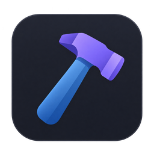
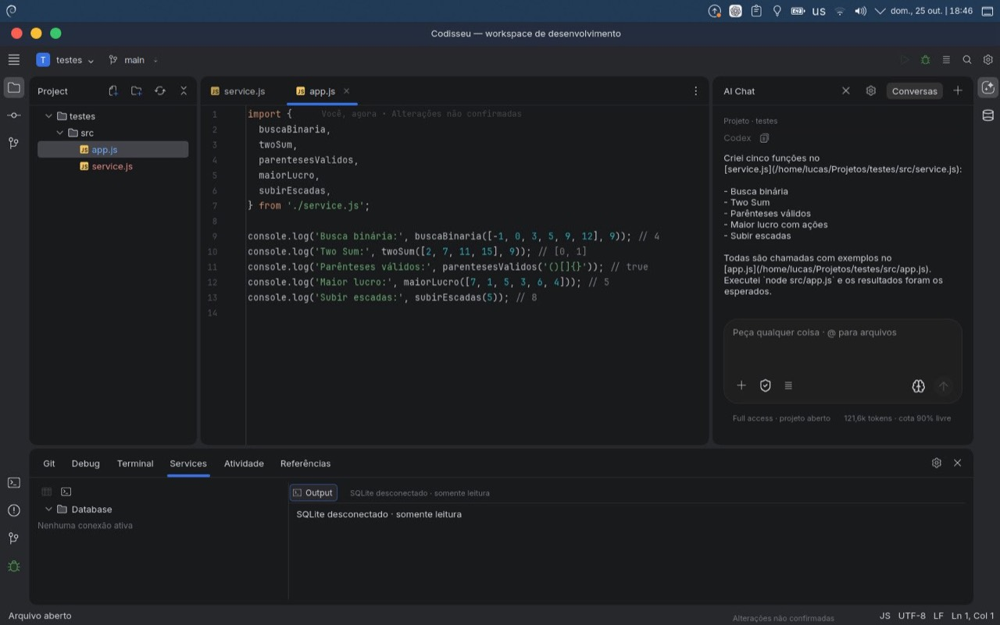
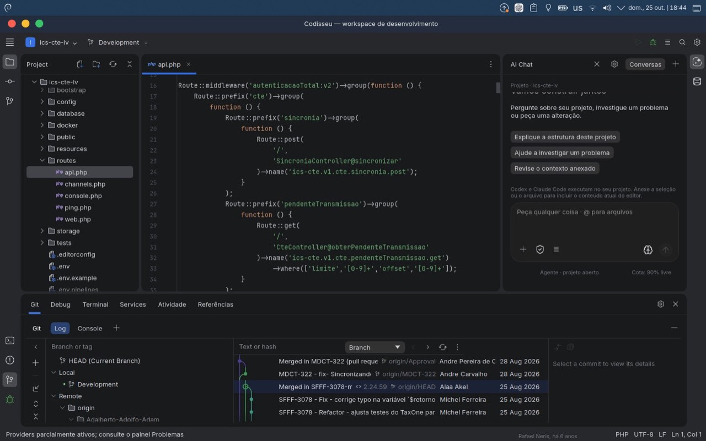
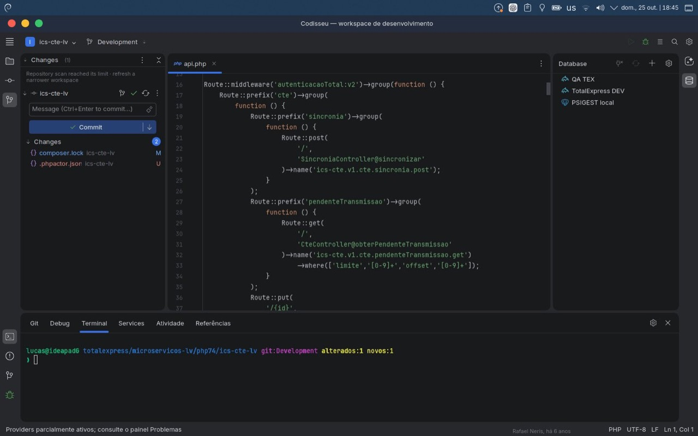

<p align="center">
  
</p>

<h1 align="center">Codisseu</h1>

<p align="center">Código, banco de dados, Git e IA. Tudo no mesmo lugar.</p>

<p align="center">
  <a href="https://github.com/lucstrik/codisseu/releases/download/v0.1.0-alpha.1/codisseu_0.1.0~alpha.1_amd64.deb">Baixar .deb para Linux</a> ·
  <a href="#instalação">Como instalar</a> ·
  <a href="#o-que-você-vai-encontrar">Recursos</a> ·
  <a href="https://github.com/lucstrik/codisseu/issues">Problemas e ideias</a>
</p>

A ideia do Codisseu é simples: abrir seu projeto e ter as ferramentas que você
precisa ali, sem ficar pulando de um programa para outro. Editar um PHP, mexer no
JavaScript, consultar o banco, ver o Git e conversar com a IA, tudo na mesma janela.

É uma IDE desktop feita em **Rust com egui/eframe**, com um único editor para as
linguagens do projeto. O foco agora é Linux.



> **Estamos na fase alpha.** Já tem bastante coisa funcionando, e o projeto
> continua evoluindo. Confira os limites abaixo antes de usar no seu dia a dia.

## Instalação

O pacote `.deb` é para **Linux x86_64 / amd64**. Baixe o arquivo
`codisseu_0.1.0~alpha.1_amd64.deb` na página de
[Releases](https://github.com/lucstrik/codisseu/releases), junto com o arquivo
de checksums da mesma versão.

Na pasta onde você baixou os arquivos, instale com:

```sh
sudo apt install './codisseu_0.1.0~alpha.1_amd64.deb'
```

Depois, é só procurar **Codisseu** no menu de aplicativos. Pelo terminal:

```sh
codisseu .                       # abre a pasta atual
codisseu                         # retoma o último projeto
codisseu -n                      # abre uma nova janela vazia
codisseu "/caminho/Meu projeto"   # abre outra pasta
```

Para remover:

```sh
sudo apt remove codisseu
```

A remoção do programa preserva seus projetos e as configurações do seu usuário.
Os detalhes de instalação, verificação dos arquivos e requisitos do sistema
estão no [guia Linux](docs/install-linux.md).

### E se eu já tiver PHP, Node ou outras linguagens instaladas?

Pode manter tudo como está. O Codisseu usa as ferramentas que você configurar,
sem trocar o PHP ou o Node do seu sistema e sem mexer no `PATH` global.

**Se você ainda não tiver essas ferramentas, pode abrir o editor e trabalhar nos
arquivos.** Este primeiro `.deb` inclui o núcleo da IDE; os interpretadores,
servidores de linguagem e adaptadores de depuração são configurados à parte.
Instalar ou abrir o Codisseu não roda `composer install`, `npm install`, downloads
ou scripts do seu projeto.

Para **executar sua aplicação**, vale a versão que ela precisa: PHP com as
extensões certas, Node compatível, o ambiente Docker ou o interpretador escolhido
por você. Instale e configure só o que fizer sentido para o seu projeto.

| Ferramenta | Quando você precisa dela |
|---|---|
| PHP e extensões do projeto | Para executar sua aplicação e seus testes na versão adequada |
| Node e gerenciador de pacotes | Para executar o frontend e os scripts do projeto |
| Servidor de linguagem | Para sugestões, diagnósticos e navegação semântica; a edição básica funciona sem ele |
| Composer, PHPUnit/Pest, Vitest/Jest | Quando o projeto usa essas ferramentas; as dependências continuam sendo dele |
| Git | Para usar as operações Git; o editor abre normalmente sem ele |
| Docker | Para trabalhar com containers, se você usa Docker |
| Conta e ferramenta de IA | Para usar o provedor escolhido no AI Chat; a assinatura não acompanha a IDE |
| Servidor de banco | Para conexões remotas; SQLite local usa o motor incluído |

Uma ferramenta ausente deve aparecer como indisponível no recurso correspondente.
Você continua podendo editar os arquivos e configurar o que falta. Se encontrar
um travamento, conte pra gente em uma [issue](https://github.com/lucstrik/codisseu/issues/new/choose).
Veja o passo a passo de [configuração das ferramentas opcionais](docs/optional-tools.md).

## O que você vai encontrar

- **Um editor para o projeto todo:** PHP, JavaScript, TypeScript, HTML, CSS, JSON,
  SQL, Rust e Python, com abas, busca, divisão de editor e destaque de sintaxe.
- **Ajuda enquanto escreve:** sugestões, documentação, navegação, referências e
  renomeação nos cenários atendidos por cada provedor de linguagem configurado.
- **Git dentro da IDE:** alterações, diff, stage, commits, branches e histórico.
- **Banco de dados junto do código:** conexões, consoles, consultas e grade de
  resultados, com recursos e limites próprios de cada banco.
- **Terminal, execução e depuração:** ferramentas de projeto e painéis de testes
  PHP, JavaScript/TypeScript, Rust e Python, com os runtimes e adaptadores preparados.
- **AI Chat:** conversas por projeto com os provedores configurados por você.
  O contexto e as permissões ficam visíveis no painel.
- **Mais ferramentas no workspace:** cliente HTTP e integração opcional com Jira.

O código também contém a integração de navegador com DevTools. O motor Chromium/CEF
é separado e **não acompanha este primeiro `.deb`**. Os guias explicam a preparação
das integrações opcionais.

No `.deb` desta alpha, **edição, terminal, SQLite, cliente HTTP sem scripts, Git
instalado e providers LSP configurados explicitamente** são o ponto de partida.
Debug, scripts JavaScript do cliente HTTP, formatação PHP e as ferramentas Python
privadas exigem motores adicionais que ainda não fazem parte desta distribuição
pública. Instalar apenas PHP ou Node no sistema não habilita esses motores.

<details>
<summary><strong>Ver o Codisseu com PHP, Git, terminal e banco</strong></summary>





</details>

As fotos foram fornecidas pelo autor e mostram o Codisseu em uso em uma versão
anterior. A interface atual pode ter diferenças. [Origem das imagens](docs/images/README.md).

## Primeiro projeto

1. Abra uma pasta pelo menu **Arquivo** ou com `codisseu .` no terminal.
2. Clique em um arquivo na árvore para começar a editar.
3. Se quiser iniciar a análise de código, confira os provedores e autorize o
   projeto quando o Codisseu pedir. Só autorize projetos em que você confia.
4. Configure o interpretador e as ferramentas do projeto quando for executar
   testes, depurar ou rodar sua aplicação.
5. Adicione uma conexão no painel **Database** quando precisar trabalhar com banco.

| Ação | Atalho Linux |
|---|---|
| Abrir arquivo | `Ctrl+O` |
| Abrir pasta | `Ctrl+Shift+O` |
| Salvar | `Ctrl+S` |
| Desfazer / refazer | `Ctrl+Z` / `Ctrl+Shift+Z` |
| Completar código | `Ctrl+Space` |
| Ver documentação do símbolo | `Ctrl+Q` |
| Ir à definição | `Ctrl+B` ou `F12` |
| Correções rápidas | `Alt+Enter` |
| Executar seleção ou instrução SQL | `Ctrl+Enter` |

Os recursos de linguagem dependem do provedor iniciado e das capacidades dele.
No navegador integrado, `F12` abre o DevTools.

## Onde aprender mais

| Quero… | Guia |
|---|---|
| Instalar ou verificar o pacote | [Instalação Linux](docs/install-linux.md) |
| Configurar PHP, Node e os providers | [Ferramentas opcionais](docs/optional-tools.md) |
| Abrir projetos pelo terminal | [Comando `codisseu`](docs/cli-usage.md) |
| Conhecer os atalhos do editor | [Editor](docs/editor-shortcuts.md) |
| Trabalhar com PHP e Laravel | [Laravel](docs/laravel.md) · [Composer](docs/php-composer.md) |
| Rodar testes | [PHPUnit/Pest](docs/php-tests-usage.md) · [Vitest/Jest](docs/js-tests-usage.md) |
| Usar Rust ou Python | [Rust](docs/rust-usage.md) · [Python](docs/python-usage.md) |
| Consultar e editar dados | [Banco de dados](docs/m4-database-usage.md) |
| Depurar uma aplicação | [Depuração](docs/debugging.md) |
| Configurar o AI Chat | [AI Chat](docs/ai-chat-usage.md) |
| Fazer requisições HTTP | [Cliente HTTP](docs/api-client-usage.md) |
| Usar o navegador ou Jira | [Navegador](docs/browser-usage.md) · [Jira](docs/jira-usage.md) |
| Compilar e contribuir | [Desenvolvimento](docs/development.md) · [Contribuições](CONTRIBUTING.md) |

## O que ainda precisa de atenção

O ambiente principal exercitado é **Linux x86_64, com Debian 13/X11**. O pacote
declara as bibliotecas necessárias, e o `apt` confere a compatibilidade na instalação.
Essa primeira versão requer `glibc` 2.39 ou mais recente; Ubuntu 22.04 não atende
a esse requisito. Isso não garante o mesmo resultado em toda distribuição ou GPU.
Wayland ainda precisa de uma rodada mais ampla de validação.
Windows, macOS e ARM ainda não têm pacote suportado nesta versão.

O Codisseu é um projeto independente. As referências de experiência são PhpStorm,
WebStorm e DataGrip; a cobertura dos recursos e dos frameworks ainda tem limites.
As integrações usam seus próprios motores e não carregam plugins desses IDEs.

Há proteção ao salvar arquivos alterados externamente, mas a recuperação de texto
não salvo depois de um crash ainda está pendente. Salve seu trabalho com frequência.
Os guias de cada recurso detalham as restrições de edição, refatoração, depuração
e banco de dados.

## Vamos melhorando juntos

Encontrou um erro? Abra uma [issue](https://github.com/lucstrik/codisseu/issues/new/choose)
com a versão do Codisseu, seu Linux e os passos para reproduzir. Um exemplo pequeno
ajuda bastante. Ideias e sugestões também são bem-vindas.

Para enviar código, veja [como contribuir](CONTRIBUTING.md). Para problemas de
segurança, siga a [política de segurança](SECURITY.md). As origens e licenças dos
componentes usados ficam no [inventário de terceiros](docs/third-party-inventory.md)
e nos avisos que acompanham o pacote.

O código do Codisseu é distribuído sob a [licença MIT](LICENSE).
Os componentes de terceiros mantêm suas próprias licenças.
